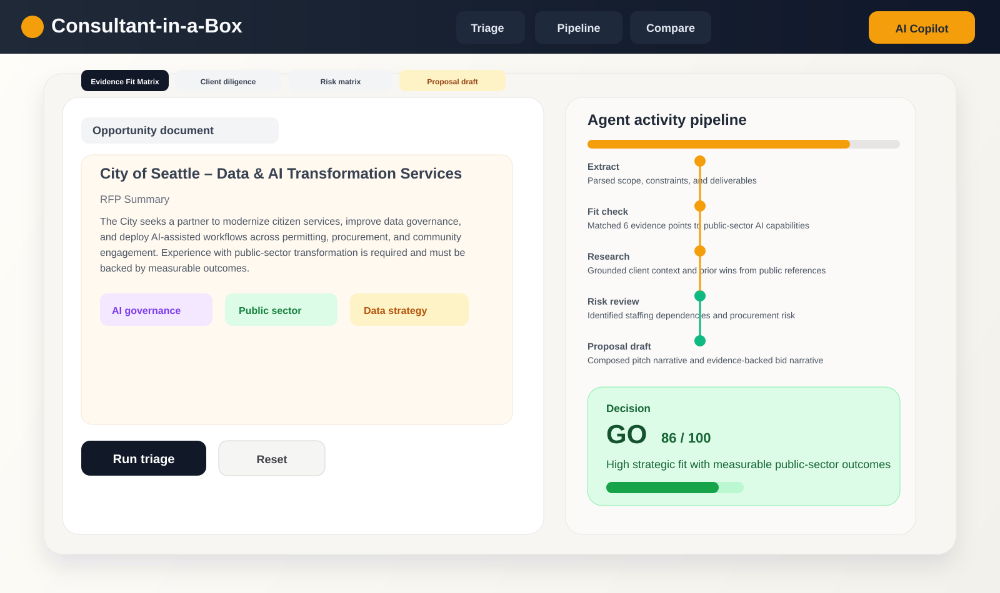

# Consultant-in-a-Box

**Multi-agent RFP triage and an evidence-backed decision engine, powered by Gemini.**

**Live demo:** https://consultant-in-a-box-inky.vercel.app (try a sample RFP; AI calls are rate-limited per visitor)

Small consultancies and agencies lose hours reading long RFP documents and still make go / no-go decisions on gut feel. Consultant-in-a-Box parses bid documents in the browser and has specialist AI agents for requirements extraction, evidence fit analysis, risk review, and proposal drafting.




### Tech stack
TypeScript · React 19 · Vite · Express (`server.ts`) · Google Gemini (`@google/genai`) · PDF and DOCX parsing (pdf.js, pdf-parse, mammoth)

### Run it locally
```bash
npm install
cp .env.example .env    # set GEMINI_API_KEY and/or GROQ_API_KEY
npm run dev             # starts server.ts with Vite middleware
npm test                # benchmark tests (tests/benchmarkTests.ts)
npm run test:fallback   # Gemini → Groq fallback tests (no network)
```
Production build: `npm run build && npm start`.

### Deploy (Vercel)
`vercel.json` serves the Vite build as static files, and all `/api/*` routes go to one Node function (`api/index.ts` → `src/server/app.ts`). Set `GROQ_API_KEY` and/or `GEMINI_API_KEY` in the project's environment variables. AI routes are rate-limited per visitor (`RATE_LIMIT_PER_HOUR`, default 10; chat `CHAT_LIMIT_PER_HOUR`, default 30). The limit is best-effort and per instance.

### Model fallback
Gemini is the primary model. If the key is missing, rate-limited (429) or the service is down, the same call is retried on **Groq** (`GROQ_API_KEY`, default `openai/gpt-oss-120b`). Image OCR falls back to a Groq vision model. Groq has no web-search grounding, so client research then comes from model knowledge, with no sources.

### Status
A working prototype, actively developed. Started from Google AI Studio tooling, then extended.

### License
MIT — see [LICENSE](LICENSE).
